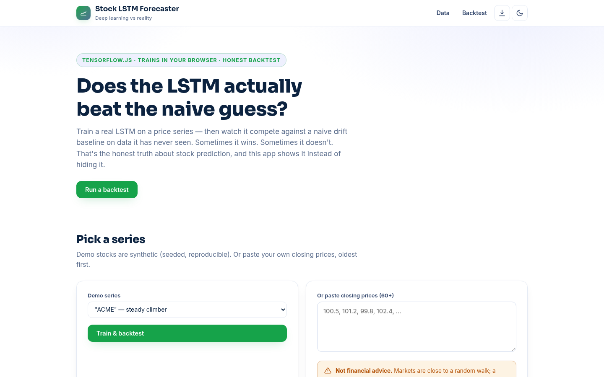

# Stock LSTM Forecaster — Deep Learning vs the Naive Baseline

**Live:** https://akash991833.github.io/stock-lstm-forecaster/

Train a real LSTM on a price series in your browser, then watch it compete against a naive drift baseline on data it has never seen. Sometimes it wins, sometimes it doesn't — and that honest comparison is the whole point. Free, private, no sign-up.



## Features

- **Real LSTM training** — 16-unit LSTM on windowed log-returns, trained live with TensorFlow.js (CPU backend for reliability)
- **Honest backtesting** — the last 30 points are held out; LSTM vs naive baseline scored with MAE and RMSE, winner marked
- **10-step forecast** — recursive multi-step forecast with per-step change percentages
- **Three demo stocks** — synthetic seeded series (steady climber, volatile, slow bleed) that reproduce exactly
- **Your own data** — paste any 60+ closing prices
- **Backtest chart** — history, holdout zone, both models and the future forecast on one canvas
- **PWA** — installable; app shell + TF.js cache for offline
- **Dark & light themes**, responsive on mobile and desktop

## How it works

1. **Framing** — log-returns, standardized; 20-day windows predict the next return
2. **Backtest** — model trains on the first N-30 points only, then predicts the holdout one step at a time
3. **Comparison** — same holdout scored for the naive drift baseline; the winner is shown, even when it's not the LSTM
4. **Final model** — retrained on all data for the 10-step forward forecast

## Honest limits

A 16-unit LSTM on returns is a teaching model, not a trading system. Prices alone carry almost no predictive signal — the naive baseline wins regularly, and this app tells you when it does. No volumes, news or fundamentals. Synthetic demo series are generated, not real market data. Nothing here is financial advice; never trade on a backtest.

## Tech

Vanilla HTML/CSS/JS + TensorFlow.js (CDN). No build step, no backend, no tracking.

## Run locally

```bash
python3 -m http.server 8000
# open http://localhost:8000
```

Built by [Akash Vishwakarma](https://github.com/AKASH991833). Free to use — no sign-up, no card.


## Stacks

- **Live demo (this repo root):** HTML/CSS/JS + TensorFlow.js — LSTM trained live in your browser on your pasted series.
- **Python pipeline (`ml/`):** TensorFlow/Keras stacked-LSTM training on your own CSV with honest naive-baseline backtest and TF.js export. See `ml/README.md`.
